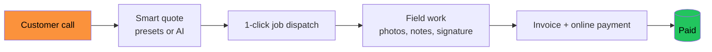

<div align="center">



       


[**Live demo**](https://tradeflow-cyan-nu.vercel.app) · [Product guide](TRADEFLOW_PRODUCT_GUIDE.md) · [Architecture](docs/ARCHITECTURE.md) · [Docs](docs)

</div>

---

## The problem

Trade businesses lose hours to sticky notes, WhatsApp threads and the same details typed three times: into the quote, the job sheet and the invoice. Legacy field-service tools are expensive and slow on a phone. **TradeFlow takes a customer from the first call to a paid invoice in minutes, on any device, without typing anything twice.**

## One pipeline, four stages



Every screen shows live status (`Draft`, `Sent`, `Scheduled`, `In Progress`, `Completed`, `Paid`) with two-way links between quote, job and invoice.

## Features

| | |
|---|---|
| ⚡ **Smart quotes** | 1-tap trade presets, an AI estimator that turns a plain-English description into line items, a client approval link, and branded PDF export |
| 📱 **Field technician hub** | Daily route, before and after photos, on-screen signature pad, parts and billables added on the fly |
| 💳 **1-click invoicing** | Job data, notes, photos and parts flow into the invoice; Stripe checkout link; partial and offline payments |
| 🔢 **Exact money** | Integer-based calculation engine for tax, discounts and partial payments |
| 🧰 **5 trade presets** | Plumbing, HVAC, electrical and EV, roofing, general contracting; switching updates the whole app |
| 🔐 **Bring your own keys** | Your own OpenAI key, Resend sender domain and Stripe account |

## Stack


Next.js 15 (App Router) · React 19 · TypeScript · Tailwind · Supabase (Postgres, Auth) · Stripe · Resend · OpenAI · Vitest · Playwright · Docker

## Getting started

```bash
npm install
cp .env.example .env.local   # fill in Supabase, Stripe, Resend, OpenAI keys
npm run dev                  # http://localhost:3000
npm run typecheck && npm test
```

Supabase migrations live in [`supabase/migrations`](supabase/migrations). Deployment notes: [`docs/DEPLOYMENT.md`](docs/DEPLOYMENT.md).

## Built by

[Yash Bankar](https://github.com/yashbank), at Crestline Technologies, in personal time, using Claude Code and AI agents under human-owned architecture and review.
